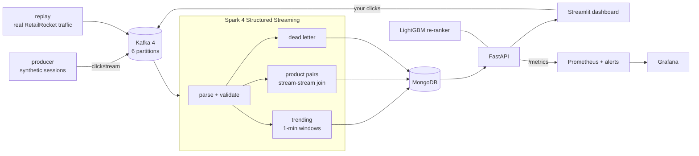
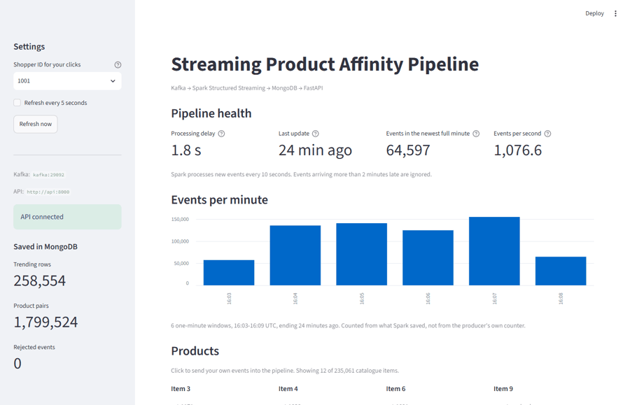
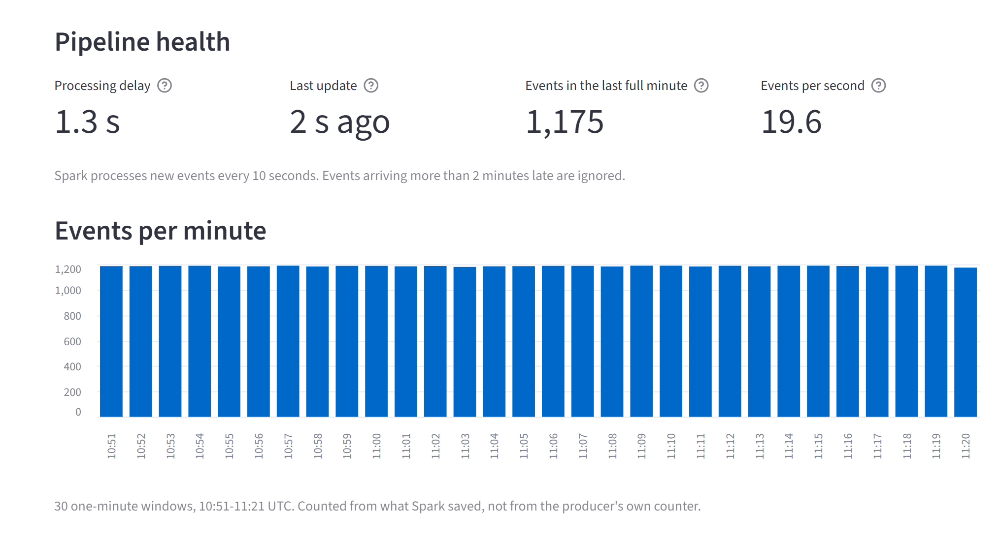
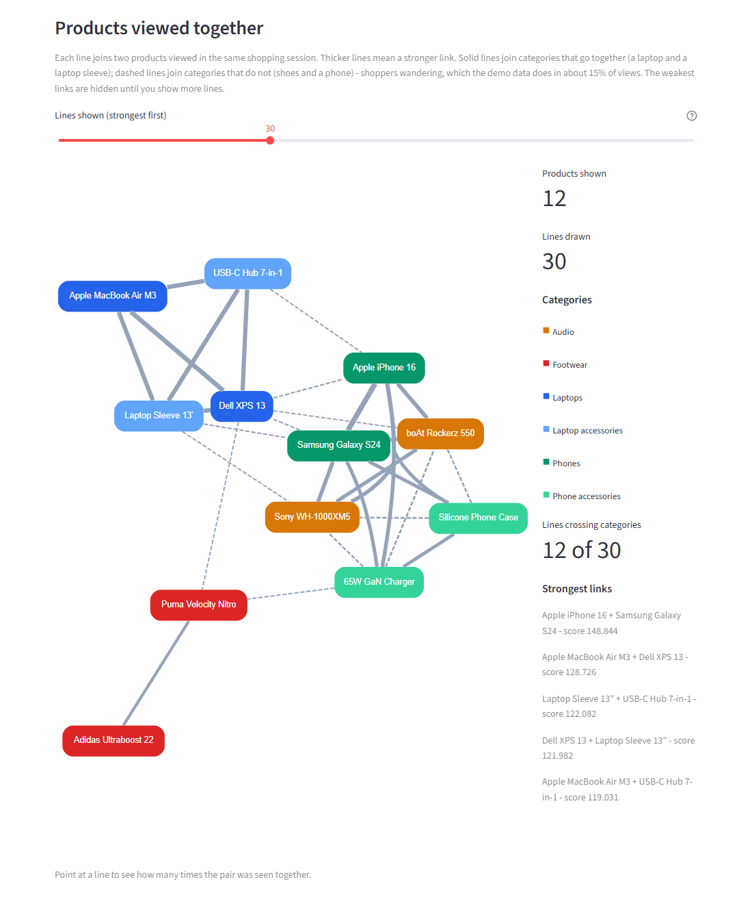
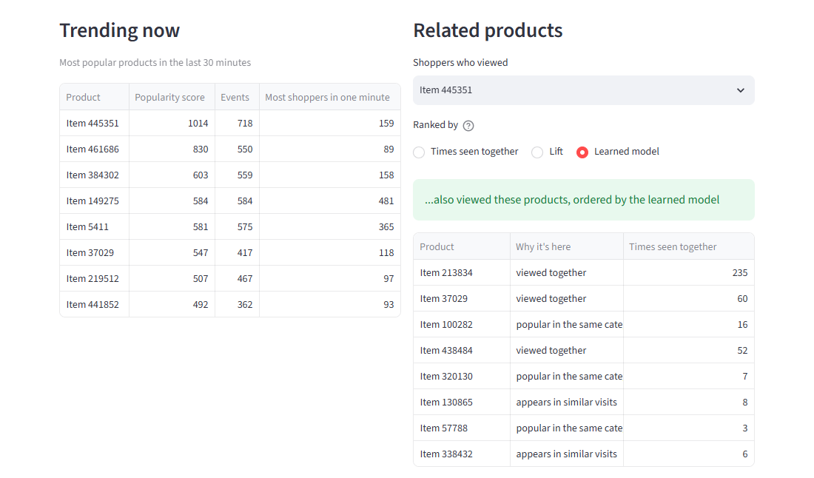
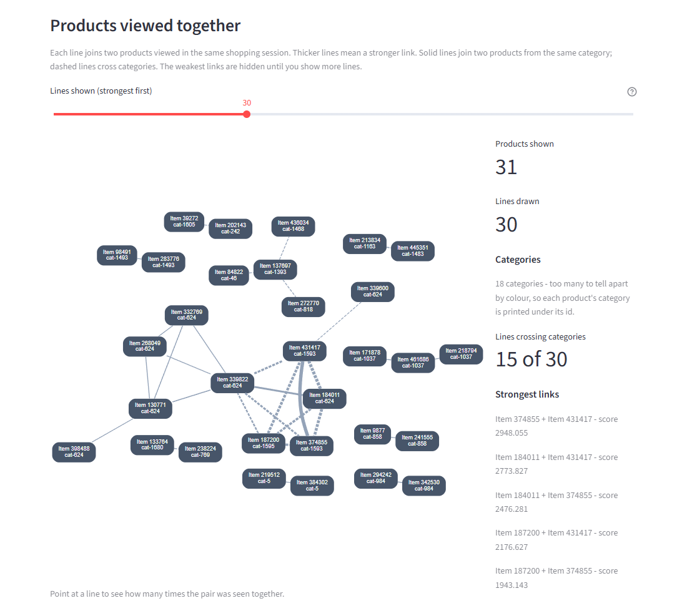
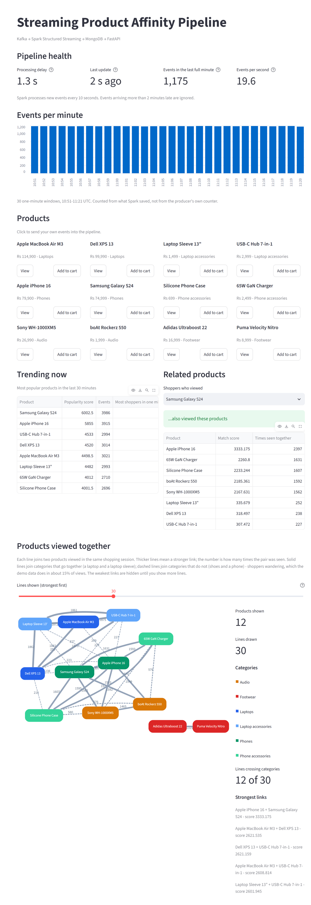

# Streaming Product Affinity Pipeline

[](https://github.com/BrishavDebnath/streaming-product-affinity/actions/workflows/ci.yml)
[](https://github.com/BrishavDebnath/streaming-product-affinity/actions/workflows/codeql.yml)
[](https://github.com/BrishavDebnath/streaming-product-affinity/blob/main/.github/workflows/ci.yml)
[](https://kafka.apache.org/)
[](https://spark.apache.org/docs/latest/structured-streaming-programming-guide.html)
[](LICENSE)

A streaming pipeline on Kafka 4, Spark 4 Structured Streaming, MongoDB and FastAPI that finds products shoppers look at together in the same visit, and a learned re-ranker on top of it. Measured on real RetailRocket traffic it beats the strongest simple baseline; the numbers are [below](#is-it-any-good).

Click events go into Kafka. Spark keeps two running results: trending products per minute, and pairs of products viewed in the same session. Both are written to MongoDB as upserts, so a crash and restart never double-counts. FastAPI serves "related products" for any item, a Streamlit dashboard shows them, and Prometheus and Grafana watch the whole thing.



One `docker compose up` starts every box.

## Scope

It answers "what goes with this item", not "what should this particular shopper see next": there is no model of the user. Most of the work is on the streaming side: bounded state, idempotent writes, a dead-letter queue, two event schemas running side by side, crash recovery, and tested transforms. The ranking has two layers. The first is co-occurrence statistics (affinity, lift or PMI), padded with the query category's bestsellers. The second is a LightGBM LambdaRank model that re-orders candidates from several sources (`score_by=learned`).

## Demo



*The dashboard on a replayed month of real traffic: pipeline health, events per minute, trending, and related products switched to the learned model, with the source behind each suggestion.*

<details>
<summary>More screenshots: pipeline health, the affinity graph, the whole dashboard</summary>







</details>

## Quick start

You need Docker Desktop (or Docker Engine with Compose v2.24+) with at least 8 GB of memory. The first build downloads Spark, the Kafka connector and the Python packages, so it takes several minutes. On a Linux host with kernel 6.19 or newer, MongoDB 8 won't start; run with `MONGO_IMAGE=mongo:7.0`.

```bash
git clone https://github.com/BrishavDebnath/streaming-product-affinity.git
cd streaming-product-affinity
docker compose up -d --build
```

| | |
|---|---|
| Dashboard | http://localhost:8501 |
| API docs | http://localhost:8000/docs |
| Grafana | http://localhost:3000 |
| Prometheus | http://localhost:9090 |
| Spark UI | http://localhost:4040 |

Trending appears within a minute and product pairs after about five. A pair is written only once its 1-minute window, the 2-minute co-view gap and the 2-minute watermark have all passed.

| | |
|---|---|
| End-to-end check | `docker compose run --rm smoke` |
| Throughput benchmark (~25 min) | `docker compose run --rm loadtest` |
| Crash-recovery test (~7 min) | `docker compose run --rm recovery` |
| Stop, keep data / delete data | `docker compose down` / `docker compose down -v` |

Settings live in `.env` (copy `.env.example`); every value has a default. On macOS and Linux the `Makefile` wraps the same commands.

## How it works

**Pairs** come from a stream-stream self-join on the session id. Two events join only if they are within `CO_VIEW_GAP` (2 minutes) of each other, and that time limit is what keeps the join's memory bounded. `l_product < r_product` stores each pair once; the sink writes the mirror so either product finds it. Pairs seen fewer than `MIN_PAIR_COUNT` (3) times are hidden. See `co_occurrence()` in [src/streaming/transforms.py](src/streaming/transforms.py) and [ADR 0002](docs/adr/0002-session-keyed-cooccurrence.md).

**Bounded state.** Every aggregation groups by an event-time window, so the watermark can evict closed windows. Without a window, state grew linearly on a 200 rows/s test; with one it stayed flat ([ADR 0001](docs/adr/0001-windowed-state.md)).

**Exactly-once results.** Sinks upsert on a natural key such as `(window_start, window_end, product_id)`, so a batch re-run after a crash overwrites instead of adding ([ADR 0004](docs/adr/0004-idempotent-writes.md)). The recovery test kills Spark with SIGKILL under load: all 120,224 events were counted once, with none lost and none doubled.

**Nothing silently dropped.** Malformed events go to a dead-letter collection with the reason. Producers send v1 and v2 events side by side, and the parser folds both onto one schema.

**Ranking.** `score_by=affinity|lift|pmi` ranks pairs by weighted count, lift or PMI ([ADR 0003](docs/adr/0003-lift-not-raw-counts.md)). Empty slots are filled with the query category's most active products, then trending. Every row says which source it came from.

**The learned re-ranker** (`score_by=learned`, [src/ranking/](src/ranking/)):

1. Candidates come from six sources: co-occurrence with no minimum count, the category's top items, item2vec neighbours, the parent category's top items, two-hop co-occurrence (the query goes with B, B goes with C), and global bestsellers. That's about 80 per query.
2. Nineteen features per candidate, all from aggregates Spark already writes: pair count, lift, share of the query's pairs, same category or parent category, popularity, recent popularity, cart rate, item2vec similarity, and the two-hop score. Trending rows carry separate view, cart and purchase counts to support them.
3. A LightGBM LambdaRank model orders them.

The trainer and the API call the same feature function, so training and serving can't drift apart. The API refuses a model whose feature list differs from the code's, and item2vec vectors trained on a different replay window. In both cases it answers with plain affinity and says why.

The dashboard's Related products panel switches between times seen together, lift and the learned model, and each row says which source proposed it. The API exports the model's age, whether it fits the data being served, its latency and its fallbacks. Grafana has a row for them, and Prometheus has three alerts: the model is over a week old, a model is loaded but can't be used, and learned requests keep falling back.

## Is it any good?

The demo traffic is synthetic, so its "right answer" is the generator's own rule. Quality is measured on [RetailRocket](https://www.kaggle.com/datasets/retailrocket/ecommerce-dataset) instead: 2.7M real events from a real shop. Replay 30 days through Kafka, then test on the 7 days after, which the pipeline never saw. For each held-out visit, ask the live API about the first product. It's a hit if the next product the shopper viewed is in the top 10.

<!-- results:start -->
| 3,000 held-out visits, days 30–37 | hit-rate@10 | Coverage |
|---|---:|---:|
| **Learned re-ranker, v1.2** (six candidate sources, 19 features) | **35.7%** | 100% |
| Learned re-ranker, v1.1 (four sources, 16 features) | 34.4% | 100% |
| Co-occurrence, then category fill (`score_by=affinity`) | 25.6% | 100% |
| Co-occurrence only¹ | 19.7% | 64% |
| Category bestsellers (top 10 of the query's category) | 20.4% | 100% |
| Global bestsellers | 0.57% | 100% |

¹ From the September run of the same split.
<!-- results:end -->

Category bestsellers is the baseline to beat. Co-occurrence alone doesn't beat it: it answers only 64% of queries. Combined with the category fill it wins by about 5 points. The learned re-ranker adds 8 to 10 points on top of that, on three separate test weeks, each with its own model and every 95% interval well above zero:

| Test week | v1.2 vs affinity | v1.2 vs v1.1 (same data) |
|---|---|---|
| days 30–37 | +10.13 (+8.70 to +11.47) | **+1.33** (+0.47 to +2.17) |
| days 60–67 | +8.07 (+6.77 to +9.37) | +0.57 (−0.33 to +1.53) |
| days 90–97 | +8.77 (+7.47 to +10.03) | +0.10 (−0.67 to +0.90) |

The newest candidate sources, two-hop and parent category, put the right answer among the candidates 2 to 3 points more often every week. The model turned only some of that into hits: about +0.7 points pooled over the three weeks, and clearly above zero only in the first. It's a small gain, honestly measured, and never a loss. It answers in 12.9 ms at the median over HTTP. Details, the training windows, and caveats are in [docs/EVALUATION.md](docs/EVALUATION.md); what changed when is in the [changelog](CHANGELOG.md).

One guard matters more than any number. If you evaluate a different window from the one replayed, you test the pipeline on its own training days. That scored 35.1% instead of the true 17.4%, and nothing errored ([bug 8](DEFECTS_FIXED.md)). So `replay.py` records what it sent, and `evaluate.py` and `train_ranker.py` both refuse a mismatch.

```bash
pip install -r requirements-data.txt -r requirements-ml.txt
python scripts/fetch_dataset.py                       # needs a Kaggle API key
python scripts/replay.py --dry-run --days 140         # catalogue for every item
CATALOG_FILE=data/catalog_retailrocket.json docker compose up -d --build

docker compose run --rm replay --days 23              # features for training
python scripts/train_ranker.py --train-days 23        # labels: days 23-30
docker compose down -v && CATALOG_FILE=data/catalog_retailrocket.json docker compose up -d
docker compose run --rm replay --days 30              # the window to serve
python scripts/train_ranker.py --train-days 30 --embeddings-only
docker compose run --rm evaluate --train-days 30 --score-by learned --compare-to affinity
```

`scripts/live_folds.sh` runs that whole sequence for any test week, and can score a previous model beside the new one on the same data.

## Performance

On one 8-core laptop with 12 GB for Docker, everything sharing the same cores ([docs/BENCHMARKS.md](docs/BENCHMARKS.md)):

- **15,000 events/s sustained**; at 20,000 it falls behind.
- **About 8 s** from event to trending row at the median, most of it waiting for the 10 s trigger.
- **Crash recovery:** first new result 12 s after restart; a 38,471-event backlog cleared in 15 s.

## Tests

160 tests, none needing Kafka or MongoDB: Spark transforms and a real streaming query on a local `SparkSession`, the API and the re-ranker over mongomock, the dashboard through Streamlit's `AppTest`, and the replay and evaluation maths. CI runs `ruff`, `mypy` and the suite on Python 3.11 and 3.12, then starts the whole stack and runs the end-to-end check.

```bash
pip install -r requirements-test.txt   # needs Java 17+ for the Spark tests
pytest
ruff check . && mypy
```

## API

| endpoint | purpose |
|---|---|
| `GET /related-products/{id}?limit=&score_by=` | related products by `affinity`, `lift`, `pmi` or `learned`, with category and trending fallbacks |
| `GET /trending?limit=&minutes=` | top products over the last N minutes |
| `GET /graph` | co-occurrence as nodes and edges |
| `GET /pipeline`, `/throughput`, `/stats` | processing delay, measured rate, counters |
| `GET /health`, `/metrics` | liveness, and Prometheus metrics including the re-ranker's latency, fallbacks and model age |

## Layout

```
src/streaming/   Spark transforms (pure, tested) and the job with its sinks
src/api/         FastAPI serving layer
src/ranking/     re-ranker: the shared feature function and model loading
src/ui/          Streamlit dashboard
src/data/        RetailRocket visits, replay clock, hit-rate evaluation
scripts/         replay, evaluate, train_ranker, seed, smoke, load and recovery tests
experiments/     the offline tests that decided which ML ideas to build
monitoring/      Prometheus config, alert rules, Grafana dashboard
docs/            decisions (adr/), evaluation, benchmarks, runbook, ML plan
```

## Known limitations

1. No personalisation: the model sees one product, not a shopper's history. 85% of RetailRocket visits view a single item, so there is little history to use.
2. One Kafka broker and Spark in local mode. Nothing has run on a real cluster.
3. No authentication on the API or the dashboard.
4. Benchmarks come from one laptop, not a cluster.

## Licence

MIT. See [LICENSE](LICENSE).
